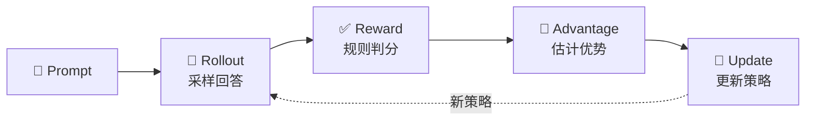

<div align="center">

# TinyLLMRL

**从零复现 LLM 强化学习算法的极简代码库**

*Minimal, from-scratch reproductions of RL algorithms for LLMs*

[](https://www.python.org/)
[](https://pytorch.org/)
[](https://github.com/huggingface/transformers)
[](https://huggingface.co/Qwen/Qwen3-0.6B)
[](https://swanlab.cn)

</div>

## ✨ 简介

TinyLLMRL 用最少的代码复现大模型上的强化学习算法，所有算法共用同一个训练循环：



- 🪶 **轻量**：只依赖 PyTorch 与 🤗 Transformers，不套用 TRL、verl 等训练框架
- 📖 **易读**：一个算法一个文件，可以对照公式逐行阅读
- 🔁 **可复现**：随机种子、数据哈希和运行配置随每次实验一起保存
- ⚡ **开箱即用**：支持单卡 / 多卡 DDP 训练，指标实时同步到 SwanLab

## 🗺️ 算法路线

| 算法 | 核心思想 | 状态 |
| :--- | :--- | :---: |
| [REINFORCE + Simple Baseline](algorithms/reinforce_simple_baseline.py) | 用奖励的滑动平均作 baseline | ✅ 已实现 |
| [REINFORCE + Learned Value Baseline](algorithms/reinforce_learned_value_baseline.py) | 学一个价值模型作 baseline | 🚧 开发中 |
| PPO | Clipped 目标 + 价值模型 | 📋 规划中 |
| GRPO | 同题采样一组回答，用组内相对奖励作优势 | 📋 规划中 |

## 🎯 实验设定

| 🤖 策略模型 | 📚 训练数据 | 🏆 奖励 | 📊 外部评测 |
| :---: | :---: | :---: | :---: |
| [Qwen3-0.6B](https://huggingface.co/Qwen/Qwen3-0.6B)<br>关闭 thinking | 合成英文加减法应用题<br>训练 800 · 验证 160 · 测试 160 | 以 `FINAL: <整数>` 作答<br>答对得 1，否则 0 | [SVAMP](https://github.com/arkilpatel/SVAMP)<br>只评测，不参与训练 |

## 🚀 快速开始

> [!NOTE]
> 训练需要 CUDA GPU，以下命令均在项目根目录执行。

**1. 安装依赖**

```bash
uv venv --python 3.11 .venv && source .venv/bin/activate
uv pip install torch==2.7.1 --index-url https://download.pytorch.org/whl/cu128
uv pip install transformers==4.57.3 huggingface_hub python-dotenv "swanlab[dashboard]"
```

**2. 下载模型**（通过 [HF-Mirror](https://hf-mirror.com/) 镜像，训练时直接从本地目录加载）

```bash
HF_ENDPOINT=https://hf-mirror.com HF_HUB_DISABLE_XET=1 \
  hf download Qwen/Qwen3-0.6B --local-dir models/weights/Qwen3-0.6B
```

**3. 生成数据**

```bash
python -m datasets.generate_arithmetic --seed 42 --output data/processed/arithmetic-v1
```

**4. 开始训练**

```bash
# 单卡
python train.py --run-name simple-v1

# 多卡 DDP（--batch-size 为全局 batch，平均分到每张卡）
torchrun --standalone --nproc-per-node=2 train.py --run-name simple-ddp-v1 --batch-size 4
```

- 📈 指标默认实时同步到 SwanLab，在环境变量或 `.env` 中设置 `SWANLAB_API_KEY` 即可
- 💾 配置、逐步指标和最终权重保存在 `outputs/<run-name>/`

<details>
<summary><b>常用参数</b></summary>

| 参数 | 默认值 | 说明 |
| :--- | :---: | :--- |
| `--run-name` | 必填 | 实验名，结果写入 `outputs/<run-name>/` |
| `--steps` | `100` | 训练步数 |
| `--batch-size` | `4` | 全局 batch 大小（每步题目数） |
| `--lr` | `5e-6` | AdamW 学习率 |
| `--max-new-tokens` | `192` | 单条回答的最大生成长度 |
| `--eval-every` | `20` | 每隔多少步做一次验证 |
| `--swanlab-mode` | `online` | `local` 只写本地看板，`disabled` 不记录 |
| `--no-save` | — | 不保存最终权重，适合短测试 |

</details>

## 📁 项目结构

```text
TinyLLMRL/
├── algorithms/          # RL 算法，一个算法一个文件
├── datasets/            # JSONL 读写与合成数据生成
├── models/policy.py     # 加载策略模型，计算回答的 log-prob
├── rollout.py           # 批量采样
├── reward.py            # 规则判分
├── train.py             # 训练入口（单卡 / DDP）
├── smoke_rollout.py     # 单条采样的冒烟测试
└── tests/               # 单元测试
```

`data/`、`models/weights/` 和 `outputs/` 在运行时生成，不纳入 Git。

## 🧪 测试

```bash
python -m unittest discover -s tests -v
```
